# Squancher's Squanch-On


**An action-MMO setup for World of Warcraft. Horde first. Hunter first.**

Squanch-On plays WoW like a third-person action game. The camera is always
locked to the mouse, a fixed Horde reticle sits in the middle of the screen,
and the unit under its dot is the unit your abilities hit, but only while you
hold right mouse. The interface (unit frames, nameplates, chat, bags, damage
meter, camera) is built around keeping your eyes on that reticle.

It is made by a Horde Hunter for that character, and it shows:

- **Horde first.** The reticle is the Horde emblem; friendly nameplates carry
  the Horde crest, and the target ring hugs it. Alliance players can use
  everything, but the art and defaults are Horde.
- **Hunter first.** The reticle's red dot and in-range glow follow Hunter Auto
  Shot range. Other classes get the full mouselook, gate, target ring and range
  cues (melee blocks, ranged and healing triangles); the dot and glow on the
  reticle itself are Hunter-only today.
- **Action first.** Steering, aiming and casting never leave mouselook. You get
  a cursor only when you hold a key for it.

[**Install**](docs/LOCAL-ASSEMBLY.md)
· [How the reticle works](docs/RETICLE.md)
· [Install and configure](#install-and-configure)
· [Changelog](CHANGELOG.md)
· [Report an issue](https://github.com/Resource-Hacker/squanchers-squanch-on/issues/new?template=bug_report.md)

**1.0.0 · Forever interface 16001 · partly verified in game.**
Everything is in one `SquanchOn/` folder: mouselook and reticle, camera, unit
frames, nameplates, buff and debuff bars, chat, drawers, a bag window, a damage
meter, tooltip presentation, one settings window, profiles, fonts and textures.
No other addon is required; the author runs it without Plater or DynamicCam. The
author has checked it live mostly solo and out of combat on the Forever client.
Combat (including nameplates on hostile mobs, their cast bars, auras and threat
colours), hostile-target debuffs, pet/party/raid frames, profile switching and
import, theme recolouring, the camera while mounted or in combat and most bag
interactions have not been verified. See [compatibility](docs/COMPATIBILITY.md#verification-status).

## A reticle no other addon has

Action-combat setups for WoW usually do one of three things:

- **Soft targeting.** The game picks a unit from a cone in front of your
  character. What you hit is the game's guess, not your aim.
- **Mouseover left on at the screen centre.** Every mouseover ability fires at
  whatever drifts under the crosshair, whether you meant it or not.
- **Help from outside the game.** Key remappers, controller emulation or
  gamepad mode do the work the addon can't.

Squanch-On does none of these, and we know of no other addon that works the
way it does:

| | |
| --- | --- |
| **The dot is the game's own pick point.** | While the camera is locked, WoW picks the mouseover unit at one exact spot on screen. The reticle's red dot is drawn on that spot (measured in game to within a quarter of a pixel), and the Horde emblem is built around the dot. What is under the dot is what you will hit: no cone, no guess. |
| **Mouseover is closed until you ask for it.** | Normal steering never feeds a mouseover ability. Hold right mouse and true mouseover opens at the dot; release and it closes at once. The camera stays locked either way. |
| **It tells you before you press.** | On a hostile unit under the open gate, the dot lights; within Auto Shot range it glows. The selected target's ring shows melee reach as blocks and ranged or healing reach as rotating triangles, and a friendly ring lights up under the reticle. |
| **Pure addon, ordinary keyboard and mouse.** | Native bindings only. No key remapper, virtual controller, gamepad mode or helper program. |
| **The cursor comes home.** | Hold Caps Lock (or Up) for the hardware cursor; release it and the cursor returns to the dot and mouselook relocks, without turning the camera. |

<p align="center">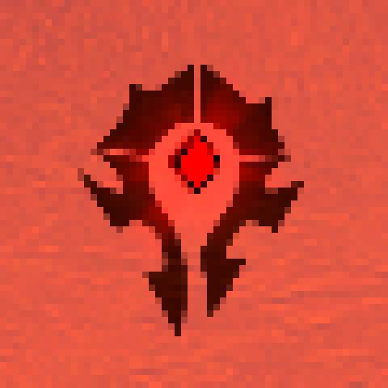</p>

<p align="center"><em>The reticle with the gate open on a hostile unit in range (preview, enlarged): the dot in the emblem's diamond, with the glow around it.</em></p>

| What you do | What happens |
| --- | --- |
| Move the mouse | Steer the camera with the native cursor hidden; mouseover at the reticle stays closed. |
| **Hold right mouse** | **Open true mouseover at the dot, keeping the camera locked.** |
| Press an ability while holding | WoW's native mouseover casting can use that unit, subject to the ability's normal rules. |
| **Release right mouse** | **Close mouseover immediately; keep steering.** |
| Hold the free-cursor key | Use the native hardware cursor for the interface. Default preset: Caps Lock / Up; [rebinding instructions](docs/RETICLE.md#getting-the-cursor-back). |
| Release the free-cursor key | Return the cursor to the dot and resume mouselook. |

First-use setup enables native mouseover casting with no modifier; later user
changes are preserved. Explicit-unit macros retain their own targeting rules.
Opening the gate does not cast a spell or automatically select a hard target.
[Controls, safeguards and implementation details →](docs/RETICLE.md)

## In game

<table>
  <tr>
    <td width="58%"></td>
    <td width="42%"></td>
  </tr>
  <tr>
    <td><strong>The world reticle.</strong> A compact Horde marker keeps the aim point visible during the author's mouselook playstyle.</td>
    <td><strong>The selected-target ring.</strong> A separate marker follows the target's visible nameplate. The ring is now one solid line inside the selected plate; this capture shows the earlier dashed art.</td>
  </tr>
</table>

These are real development gameplay details from the author's earlier setup,
with Plater nameplates. They illustrate the reticle and target artwork; a still image does
not demonstrate the hold/release transition or certify the rewrite.
[Image provenance and credits](docs/images/README.md).

## Read range at a glance


The selected visible target has a solid ring (the legend above still shows the
earlier dashed art) and a brief whole-ring click pulse. Cardinal blocks indicate
conservative five-yard melee reach on hostile targets. Rotating triangles
indicate a learned ranged damage ability against a hostile target, or a learned
healing ability against a friendly target. Hunter Auto Shot keeps its native
range check; Mend Pet and Health Funnel apply only to the player's own pet.

The ring belongs to the selected nameplate: it is cut around the health bar and,
on a friendly target, fits around the faction emblem. On players it wears the
health bar's texture and colour by default ("health bar look"); a hostile
player's ring shifts from the class colour as health drops and pulses in execute
range. NPCs keep the plain ring coloured by health. Fit, width, line thickness
and the health bar look per kind of target are settings.

Range needs no other addon or library. A shared range module
(`SquanchOn/Range.lua`) answers distance questions from learned spells and
item-range checks; its item list derives from LibRangeCheck-3.0 (MIT). A cue stays hidden when the range is unknown.
Friendly ring rotation alone is proximity feedback; healing range uses the
triangles. Range feedback does not guarantee mana, cooldown, form or line of
sight. [Exact marker meanings and current limits](docs/RETICLE.md#target-range-feedback).

## What it looks like

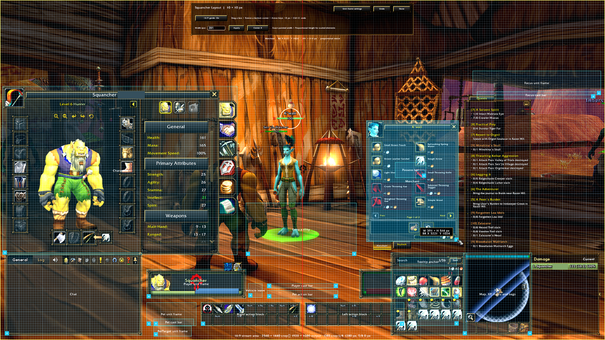

*The layout editor (`/sqedit`) over the whole interface: every element can be dragged and resized on a 10-pixel grid.*

| One settings window (`/squanchon`) | Unit frames, per unit |
| --- | --- |
| 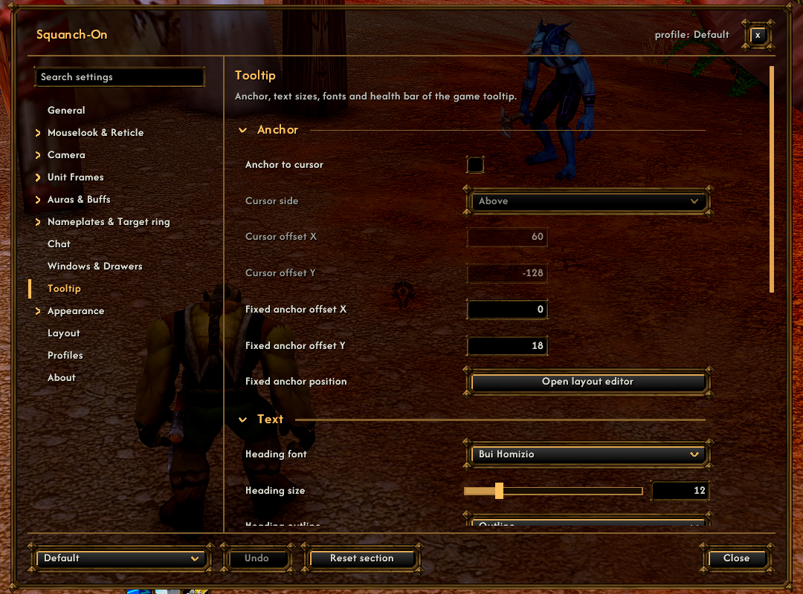 | 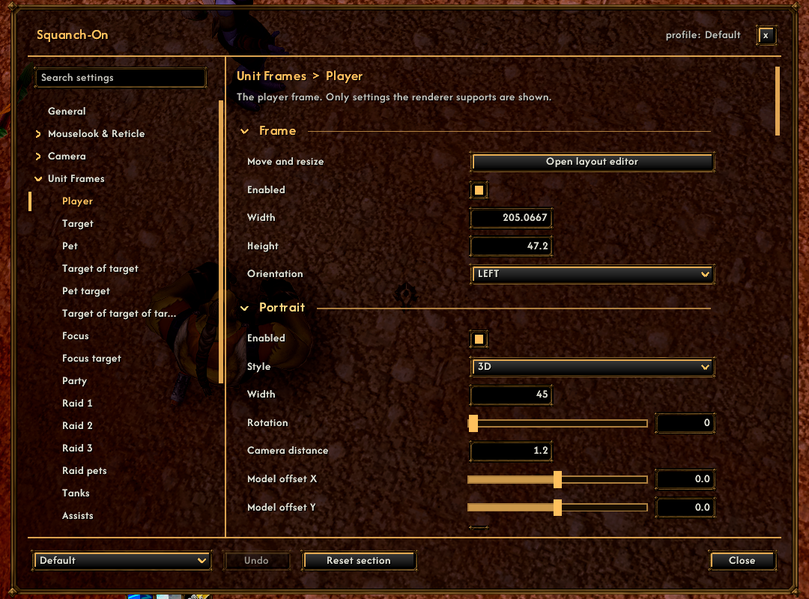 |

| Camera with zoom curves | Chat header with the menu icons |
| --- | --- |
| 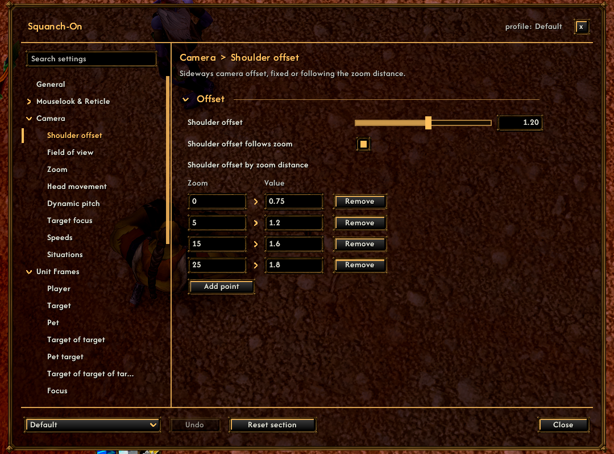 | 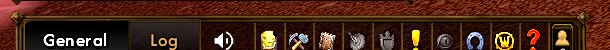 |

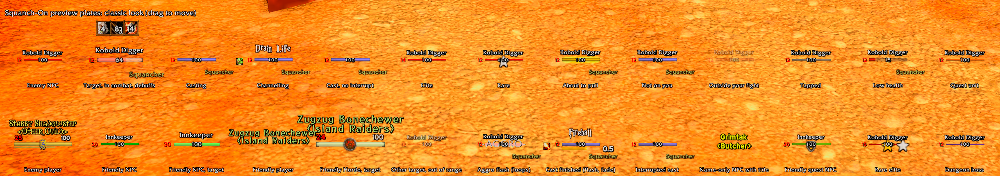

*Squanch-On's nameplates in the `/sqplates test on` preview. The units are made up by the preview; this is not live combat.*

| Bags, quests, minimap and damage meter | Character sheet as a chat drawer |
| --- | --- |
| 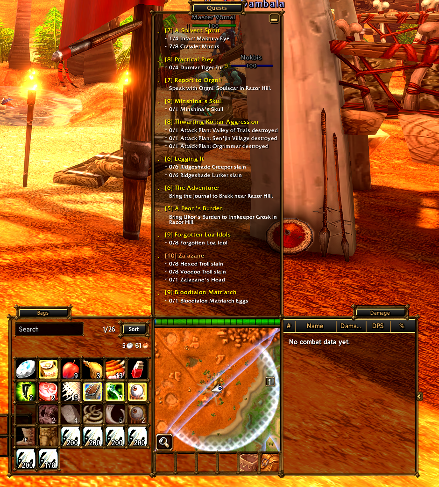 | 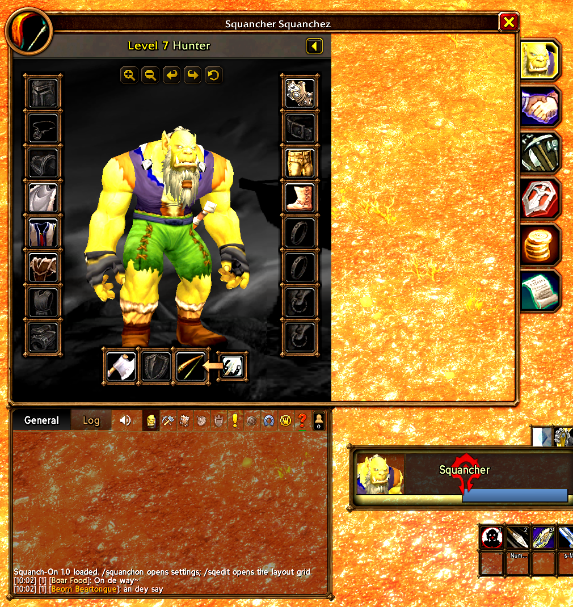 |

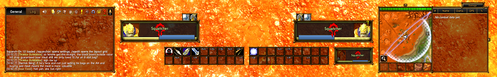

*The bottom strip in play. Out of combat at full health with no target, the player frame steps aside.*

| Graphics sliders past the game's top level |
| --- |
| 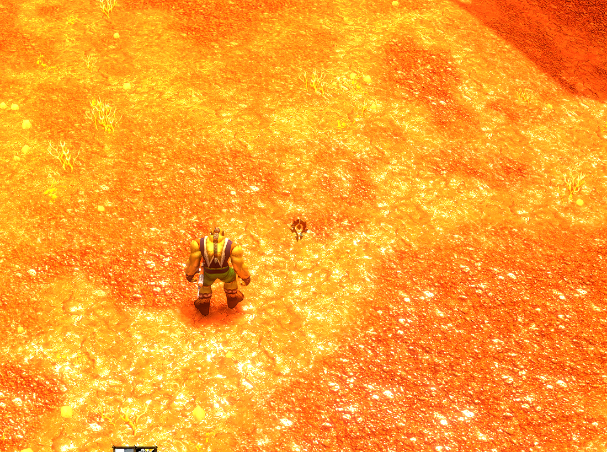 |

## An interface built around that playstyle

- **One settings window:** `/squanchon` opens a single window with a category
  tree, search, undo and reset. Changes apply live; a change that is restricted
  in combat is queued until combat ends.
- **Profiles:** one addon-wide profile, selected per character. Create, copy,
  rename, delete, reset, and export or import as a text string. Settings from an
  earlier version are migrated at first login; a backup of them stays in the
  saved file.
- **Unit frames:** independently written health/power layout, portraits, casts,
  text and group presentation built on oUF. The settings pages expose the
  renderer's supported controls; they do not reproduce the full ElvUI editor.
- **Buff and debuff icons:** split buff/debuff rows above the player and target
  frames, and two movable player bars ("Buff bar", "Debuff bar") that replace
  the game's own rows. Temporary weapon enchants appear on the buff bar, for
  display only. `/sqauras` previews the layout. All of it is configurable.
- **Chat and drawers:** the chat header holds the micro-menu icons and Friends.
  Windows opened from them appear as drawers above the chat, at the chat's
  width, with an unfold animation. The quest list is a drawer above the minimap.
- **Bag window:** one combined inventory grid with the game's real item
  buttons, search, sort and money. It slides out to the left of the minimap. The
  bank is not included yet and keeps the game's own window.
- **Damage meter:** a drawer on the right of the minimap, sized so that minimap
  plus meter equals the chat width. It is a table with column headers (#, Name,
  amount, DPS or HPS, %), first names only by default; the title plate is the
  mode button and also lists earlier fights. It shows the game's own
  `C_DamageMeter` totals; addons cannot read the combat log on this client.
- **Its own camera:** every DynamicCam setting, including zoom curves and
  situations, with a settings page; wheel zoom follows DynamicCam's easing
  algorithm (ported under MIT). DynamicCam is not needed. If it is loaded,
  Squanch-On's camera stays inactive, and its profile is imported once.
- **Graphics sliders on their full scale:** View Distance, Environment Detail and Ground Clutter continue past the game's level 10 up to what the engine accepts, in the game's own Graphics settings and on a Graphics page, with a reset to the game's values.
- **Theme, text and media:** rim, fill and text colours, text sizes, chat and
  drawer settings; generated status-bar textures and borders and bundled SIL OFL
  fonts to choose from. Bags, the meter and the settings window have raised
  title plates; headings are drawn like an unselected chat tab label. LibSharedMedia is not bundled: Squanch-On registers its
  media there only when another addon has loaded it.
- **Tooltips:** shared presentation and default anchors while Blizzard retains
  tooltip content, comparisons and native health handling.
- **A layout you can tune:** `/sqedit` moves and resizes supported components with
  a centered alignment grid, width controls and session undo.
- **Nameplates:** Squanch-On draws its own nameplates, the target ring and the
  nameplate indicators. The defaults reproduce the author's previous nameplate
  layout; optional enhancements stay off while "Classic look" is on (the
  default). A raid mark shows only on marked units. `/sqplates test` previews
  the plates. Plater is not needed. If it is loaded, Squanch-On's nameplates
  stay off and small adapters fit the ring and shared look to Plater's plates.

The package is one complete **SquanchOn** addon folder, including its oUF,
LibDispel, LibSerialize, LibDeflate and LibStub libraries
with their own notices. ElvUI and BenikUI implementations are not copied into
the rewrite or loaded as dependencies.

With no saved settings, the first run starts from the author's layout. Its
positions were authored on a 5120x1440 display; on other resolutions, use
`/sqedit` to move things. The layout's text uses PT Sans Narrow and five
bundled SIL OFL fonts made for it (Squanch Highway, Round, Square, Bolt and
Comic): modified versions of Red Hat Display, Orbitron, Amarante and Comic Neue,
rescaled and respaced to the layout's text metrics. The author's original fonts
are not distributed, so letter shapes differ. Also bundled: Overpass, Afacad,
Oxanium, Almendra, Barlow Condensed, Saira Condensed, Archivo Narrow, Oswald, Bebas Neue,
Cinzel, Metamorphous, Silkscreen, Pixelify Sans and Share Tech Mono. Frame
textures are original; the Horde reticle ships under
GPL-2.0. [Package and component licenses](docs/COMPONENT-LICENSES.md).

## Install and configure

1. Close the game and back up `Interface/AddOns` and `WTF`.
2. Copy the single `SquanchOn/` folder into `Interface/AddOns`
   ([installation page](docs/LOCAL-ASSEMBLY.md)).
3. Disable other addons that own unit frames, tooltips, bags or the buff rows.
   Plater and DynamicCam are not needed. If you keep them, Squanch-On's
   nameplates stay off while Plater is loaded and its camera stays inactive
   while DynamicCam is loaded; `/sqms camera takeover` imports the DynamicCam
   profile and disables DynamicCam.
4. Log in. An existing `SquanchOnDB` is kept and migrated to a profile;
   otherwise the author's layout is used. Adjust positions with `/sqedit`.

| Command | Purpose |
| --- | --- |
| `/squanchon` or `/squancher` | The settings window; add a page name or search words |
| `/sqedit` or `/squanchon edit` | Move and resize the interface |
| `/sqms` | Mouselook controls, status and help |
| `/sqms off` | Disable Squanch-On mouselook control |
| `/sqms nameplates` / `/sqms crosshairs` | Nameplate indicator and target ring settings |
| `/sqauras [count]` | Preview placeholder buff and debuff icons; run again to stop |
| `/sqplates test [on\|off\|enh]` / `/sqplates debug` | Preview nameplates with made-up units (`enh` adds the enhancements row) / print one line per visible plate |
| `/sqms camera status` | Camera status |
| `/sqms camera options` | Camera settings, zoom curves and situations |
| `/sqms camera on` / `off` / `restore` | Drive the camera / stop / stop and put back the earlier camera CVars |
| `/sqms camera takeover` / `release` | Disable DynamicCam in favor of Squanch-On's camera / hand the camera back |
| `/sqms camera capture` | With DynamicCam still loaded: import its selected profile again |

Saved settings live in the normal `SavedVariables/SquanchOn.lua` file as
`SquanchOnDB`: named profiles, the profile each character uses, and per-account
records. Settings the pages do not show are preserved as data. Blizzard still
owns tooltip content and comparisons. The package's default layout carries no
per-character records, account exports or macros. [Supported controls and limits](docs/COMPATIBILITY.md#settings-and-supported-controls).

## Development and attribution

From a **source checkout**, install Python 3 and Lua 5.1 (`luac5.1`), then run:

```sh
python tools/package.py
```

The builder checks Lua syntax, TOC/XML dependencies and recorded reuse hashes,
then packages tracked addon files into `dist/` with a SHA-256 checksum.
For isolated review before new source is tracked, explicit `--working-tree`
includes those addon files; `--check-only` validates without creating a ZIP. GitHub
Actions runs the same packaging checks. These checks do not certify game behavior.
See [contribution guidance](CONTRIBUTING.md) and [compatibility](docs/COMPATIBILITY.md).

Original Squanch-On code and generated artwork use the [MIT license](LICENSE).
The Horde reticle code, data and media are GPL-2.0-only. The bundled fonts are
SIL OFL 1.1. Choonster's TargetNameplateIndicator contribution, the parts of
`Camera.lua` ported from DynamicCam, oUF, LibDispel, LibSerialize and the
LibRangeCheck-3.0 item data in `Range.lua` (all MIT) and LibDeflate (zlib) retain their own notices; LibStub
retains its public-domain declaration. See
[THIRD_PARTY_NOTICES.md](THIRD_PARTY_NOTICES.md) and
[reuse-manifest.json](reuse-manifest.json) for exact scopes and file hashes.
Game-provided art and gameplay images retain Blizzard's rights. This project is
not endorsed by Blizzard or the referenced addon projects.
