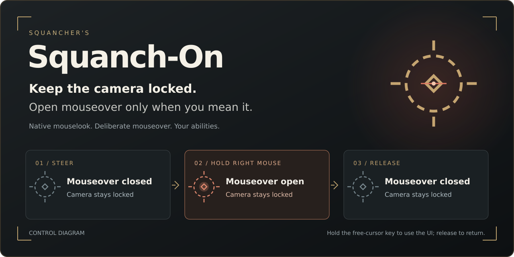
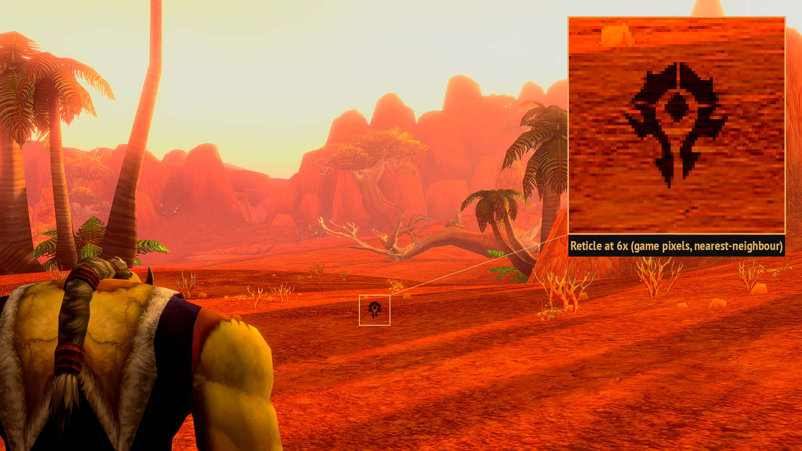
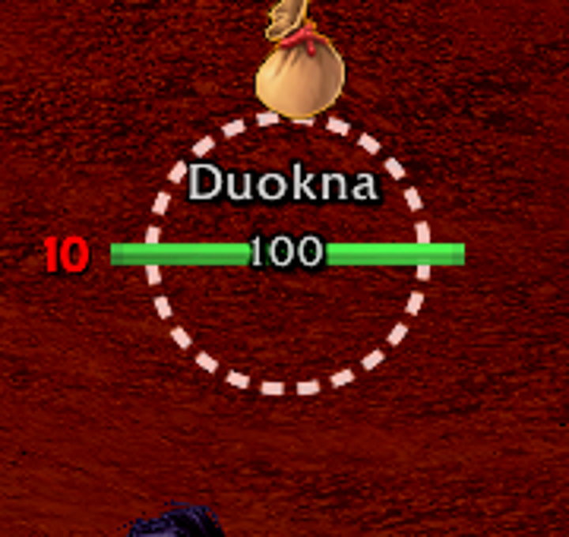
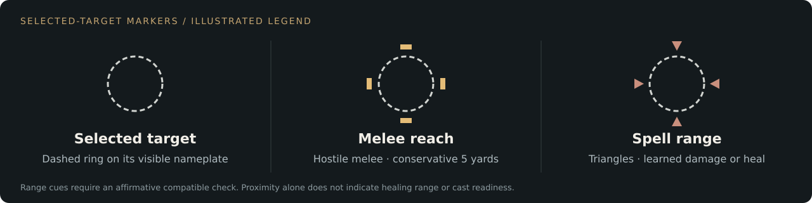

# Squancher's Squanch-On



**Keep the camera locked. Open mouseover only when you mean it.**

Squanch-On builds a World of Warcraft interface around a deliberate reticle control:
move the mouse to steer, **hold right mouse to open real mouseover at the reticle**,
then release to close mouseover while the camera stays locked. Hold the free-cursor
key when you need the interface; release it to return to mouselook.

[**Install**](docs/LOCAL-ASSEMBLY.md)
· [How the reticle works](docs/RETICLE.md)
· [Install and configure](#install-and-configure)
· [Changelog](CHANGELOG.md)
· [Report an issue](https://github.com/Resource-Hacker/squanchers-squanch-on/issues/new?template=bug_report.md)

**0.3.0-rewrite · Forever interface 16001 · partly verified in game.**
Everything is in one `SquanchOn/` folder: unit frames, aura icons, tooltip
presentation, settings controls, the Horde reticle, fonts and textures. No other
addon is required. It has been checked live only solo, out of combat, with the
player targeting themselves. Hostile targets, debuffs, combat, pet, party/raid
frames, the tooltip and the settings editor have not been verified in this
rewrite. See [compatibility](docs/COMPATIBILITY.md).

## The reticle is the control

Normal locked mouselook keeps centered mouseover **closed**. Holding right mouse
temporarily makes the unit under the aim center available to WoW's actual
`mouseover` system. Releasing right mouse closes that gate immediately, with
mouselook still active. You decide when aiming should affect a mouseover ability.

| What you do | What happens |
| --- | --- |
| Move the mouse | Steer the camera with the native cursor hidden; centered mouseover stays closed. |
| **Hold right mouse** | **Open true mouseover at the reticle, keeping the camera locked.** |
| Press an ability while holding | WoW's native mouseover casting can use that unit, subject to the ability's normal rules. |
| **Release right mouse** | **Close centered mouseover immediately; keep steering.** |
| Hold the free-cursor key | Use the native hardware cursor for the interface. Default preset: Caps Lock / Up; [rebinding instructions](docs/RETICLE.md#getting-the-cursor-back). |
| Release the free-cursor key | Return the cursor to the center and resume mouselook. |

First-use setup enables native mouseover casting with no modifier; later user
changes are preserved. Explicit-unit macros retain their own targeting rules.
Opening the gate does not cast a spell or automatically select a hard target.
The native mouselook, hold-to-open mouseover and cursor-return features run inside
the addon. [Controls, safeguards and implementation details →](docs/RETICLE.md)

## In game

<table>
  <tr>
    <td width="58%"></td>
    <td width="42%"></td>
  </tr>
  <tr>
    <td><strong>The world reticle.</strong> A compact Horde marker keeps the aim point visible during the author's mouselook playstyle.</td>
    <td><strong>The selected-target ring.</strong> A separate dashed marker follows the target's visible nameplate.</td>
  </tr>
</table>

These are real development gameplay details from the author's earlier setup,
with Plater. They illustrate the reticle and target artwork; a still image does
not demonstrate the hold/release transition or certify the rewrite.
[Image provenance and credits](docs/images/README.md).

## Read range at a glance



The selected visible target has a dashed ring and a brief whole-ring click pulse.
Cardinal blocks indicate conservative five-yard melee reach on hostile targets. Rotating triangles
indicate a learned ranged damage ability against a hostile target, or a learned
healing ability against a friendly target. Hunter Auto Shot keeps its native
range check; Mend Pet and Health Funnel apply only to the player's own pet.

Five-yard melee and friendly/NPC proximity checks need **LibRangeCheck-3.0**,
normally supplied by optional **Plater**. Those cues stay hidden when no library
is available. Friendly ring rotation alone is proximity feedback; healing range
uses the triangles. Range feedback does not guarantee mana, cooldown, form or line
of sight. [Exact marker meanings and current limits](docs/RETICLE.md#target-range-feedback).

## An interface built around that playstyle

- **Native bags and bank:** Blizzard owns item use, sorting, deposits and tooltips;
  Squanch-On supplies the shared visual treatment.
- **Unit frames:** independently written health/power layout, portraits, casts,
  text and group presentation built on oUF. The new editor exposes the
  renderer's supported controls; it does not reproduce the full ElvUI editor.
- **Buff and debuff icons:** drawn by Squanch-On on one line above the player and
  target frames (player: debuffs left, buffs right; target: buffs left, debuffs
  right; a gap in the middle; overflow stacks upward). Two movable bars, "Buff
  bar" and "Debuff bar" in `/sqedit`, replace the game's own buff and debuff
  rows. Temporary weapon enchants are not shown on the buff bar. The separate
  proc, enhancement and cooldown tracker panels are currently off.
- **Tooltips:** shared presentation and default anchors while Blizzard retains
  tooltip content, comparisons and native health handling.
- **A consistent theme:** dark translucent panels, gold equipment-style borders,
  native action and pet bars, chat, minimap, menus and other native windows.
- **A layout you can tune:** `/sqedit` moves and resizes supported components with
  a centered alignment grid, width controls and session undo.
- **Optional integrations:** Plater retains nameplate behavior; DynamicCam can
  own camera framing. Both are installed separately.

The package is one complete **SquanchOn** addon folder, including its required
oUF, LibDispel and LibStub libraries with their own notices. ElvUI and BenikUI
implementations are not copied into the rewrite or loaded as dependencies.

With no saved settings, the first run starts from the author's layout. Its
positions were authored on a 5120x1440 display; on other resolutions, use
`/sqedit` to move things. Text uses bundled SIL OFL fonts that stand in for the
author's original fonts, which are not distributed, so text shapes are close but
not identical. Frame textures are original; the Horde reticle ships under
GPL-2.0. [Package and component licenses](docs/COMPONENT-LICENSES.md).

## Install and configure

1. Close the game and back up `Interface/AddOns` and `WTF`.
2. Copy the single `SquanchOn/` folder into `Interface/AddOns`
   ([installation page](docs/LOCAL-ASSEMBLY.md)).
3. Disable other addons that own unit frames, tooltips or the buff rows. Plater
   and DynamicCam are optional and installed separately.
4. Log in. An existing `SquanchOnDB` is kept; otherwise the author's layout is
   used. Adjust positions with `/sqedit`.

| Command | Purpose |
| --- | --- |
| `/sqms` | Mouselook controls, status and help |
| `/sqms off` | Disable Squanch-On mouselook control |
| `/sqms nameplates` / `/sqms crosshairs` | Indicator settings |
| `/squanchon` or `/squancher` | Unit-frame settings and profiles |
| `/sqedit` or `/squanchon edit` | Move and resize the interface |
| `/sqauras [count]` | Preview placeholder buff and debuff icons; run again to stop |
| `/squanchon tooltip` | Tooltip text, opacity and anchors |
| `/sqms camera` | DynamicCam framing status |
| `/sqms camera setup` / `/sqms camera restore` | Create a separate framing profile / restore the saved source profile |

Saved settings live in the normal `SavedVariables/SquanchOn.lua` file as
`SquanchOnDB`, including the rewrite's unit-frame profiles. The new editor shows
supported renderer controls and preserves other settings as data. Blizzard still
owns tooltip content and comparisons. The package's default layout carries no
per-character records, account exports or macros. [Supported controls and limits](docs/COMPATIBILITY.md#settings-and-supported-controls).

## Development and attribution

From a **source checkout**, install Python 3 and Lua 5.1 (`luac5.1`), then run:

```sh
python tools/package.py
```

The builder checks Lua syntax, TOC/XML dependencies and recorded reuse hashes,
then packages tracked addon files into `dist/` with a SHA-256 checksum.
For isolated review before new source is tracked, explicit `--working-tree`
includes those addon files; `--check-only` validates without creating a ZIP. GitHub
Actions runs the same packaging checks. These checks do not certify game behavior.
See [contribution guidance](CONTRIBUTING.md) and [compatibility](docs/COMPATIBILITY.md).

Original Squanch-On code and generated artwork use the [MIT license](LICENSE).
The Horde reticle code, data and media are GPL-2.0-only. The bundled fonts are
SIL OFL 1.1. Choonster's TargetNameplateIndicator contribution, oUF and
LibDispel retain their own notices; LibStub retains its public-domain declaration. See
[THIRD_PARTY_NOTICES.md](THIRD_PARTY_NOTICES.md) and
[reuse-manifest.json](reuse-manifest.json) for exact scopes and file hashes.
Game-provided art and gameplay images retain Blizzard's rights. This project is
not endorsed by Blizzard or the referenced addon projects.
