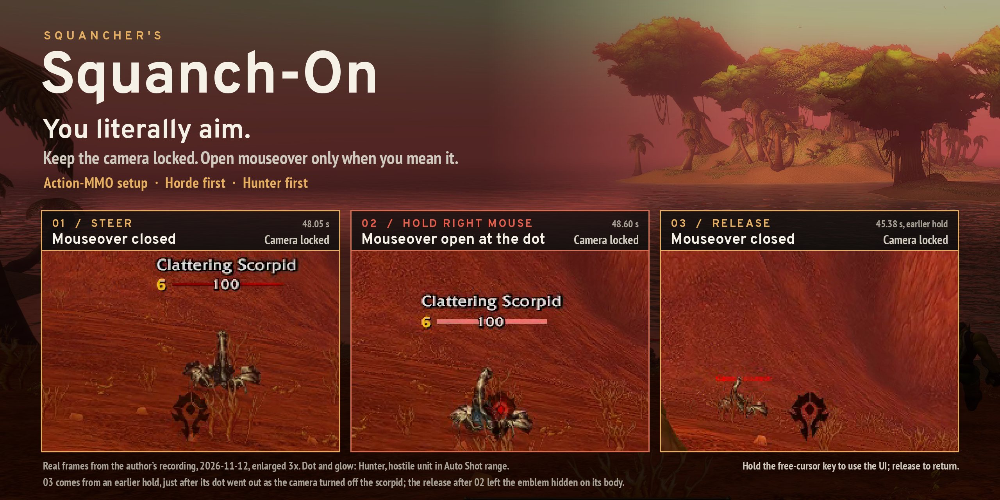
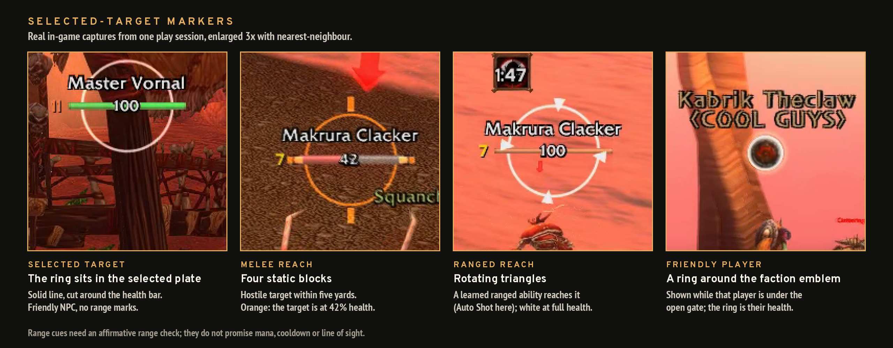

# Open mouseover at the reticle

Squanch-On's defining interaction is a **hold-to-open mouseover gate during
persistent native mouselook**. Camera control continues across both edges of the
right-button press.

## Three states, one camera

1. **Steer.** Native mouselook is active and the native cursor is hidden. Centered
   mouseover is closed; the reticle artwork can remain visible.
2. **Hold right mouse.** The native down/up binding opens centered mouseover.
   The unit picked by the game under its aim center becomes available through
   WoW's real `mouseover` unit token. Continue steering and press the ability
   you want to use.
3. **Release right mouse.** Mouseover closes immediately. Mouselook remains active.

This lets the player deliberately decide when the aim center should participate
in mouseover targeting. A selected target can remain separate from the unit
under the reticle. The gate itself never casts or selects a hard target.

First-use character setup enables native mouseover casting and sets its modifier
to None. A one-time receipt preserves subsequent user changes. Ordinary action
buttons use the client's targeting behavior; explicit macro targets such as
`[@target]`, `[@focus]` and `[@player]` remain authoritative. Valid unit, spell
range, resources, cooldown and line of sight still matter.

## Getting the cursor back

Hold the free-cursor binding to temporarily release mouselook and use the UI.
Release that binding to return to the center and relock. The default override
bindings are **Caps Lock and Up**, including their modifier combinations.
The native Key Bindings panel exposes the free-cursor action and manual
toggle/lock/unlock actions. To replace the Caps Lock/Up preset, run **`/sqms bindings off`**,
then assign **Hold to release mouselook** in WoW's Key Bindings. This removes the
preset overrides, including the historical F8/F9 helper bindings. `/sqms` shows
controls and status; `/sqms off` turns off this mouselook controller.

Supported menus, layout editing, text entry and ground-targeted abilities suspend
or defer the lock as appropriate. Reopening the lock starts with mouseover closed;
only a still-valid held right-button state can open it again. Protected binding
updates defer during combat.

The cursor is the **native hardware cursor**. Mouselook, the mouseover gate and
cursor return run inside the addon. The author's separate legacy combined-click
helper (interact on left-down, target on left-up while right is held) is not
bundled or required for these features; that historical chord is not an advertised
portable feature of this release.

## Target range feedback

The screen-center reticle and selected-target nameplate marker have different
jobs. The first exposes mouseover when held; the second keeps an existing target
visible and adds range feedback.

| Marker | Meaning | Evidence needed |
| --- | --- | --- |
| Solid ring | The selected target's visible nameplate; validated world clicks briefly pulse the whole ring. On players it wears the health bar's texture and colour by default. | Current target and matching visible nameplate. |
| Cardinal blocks | Conservative five-yard melee reach on living hostile targets. | An affirmative five-yard check from the shared range module. |
| Rotating triangles, hostile | A learned ranged damage ability is in range. | Native spell range; Hunter Auto Shot retains its own check. |
| Rotating triangles, friendly | A learned healing ability is in range. | A known spellbook rank with an affirmative native range result. |
| Friendly ring rotation without triangles | Proximity feedback, also usable for compatible NPCs. | The shared range module places the unit within the friendly threshold (40 yards by default). |

The legend shows stills from the author's play on 2026-11-12; in game the
triangles rotate. The shared range module
([`Range.lua`](../SquanchOn/Range.lua), item list derived from LibRangeCheck-3.0, MIT) combines learned-spell checks,
item-range checks, interact distance, nameplate visibility and, for group
members outdoors, the exact group distance. No other addon is needed. In combat
the client blocks item and interact checks on units the player cannot attack, so
friendly range there rests on spells, nameplates and visibility only. Unknown,
restricted or unavailable range data never enables a range marker.

The ring lives inside the selected nameplate and is cut around its health bar.
On a friendly target it fits around the faction emblem of Squanch-On's own
nameplate; its fit, width and line thickness are settings (Nameplates & Target
ring). On players it can wear the health bar's texture and colour ("health bar
look", on by default for friendly and hostile players); NPCs keep the plain ring
coloured by health. A hostile player's ring shifts from the class colour as
health drops and pulses in execute range. For users who keep Plater, an adapter
fits the ring to Plater's nameplate icon instead.

Healing candidates cover learned spells for Druid, Paladin, Priest and Shaman on
the target client. Hunter Mend Pet and Warlock Health Funnel are restricted to the
player's own pet. Spellbook, specialization and form changes refresh the cache.
This is range feedback, not a promise that a spell is currently castable. Class
coverage in source is not a completed in-game acceptance matrix.

## Why no other addon works like this

Plenty of addons have crosshairs, camera control or targeting help. None we
have found combines these:

1. **Persistent native mouselook.** The camera never unlocks for aiming or
   casting; you get a cursor only while you hold the free-cursor key.
2. **A held gate on real mouseover.** Mouseover at the reticle is closed while
   you steer and opens only while right mouse is held. It is WoW's real
   `mouseover` unit, used by native mouseover casting, not a macro layer and not
   soft targeting.
3. **The dot on the game's pick point.** The reticle's red dot is drawn where the
   client picks that mouseover unit (`GetCursorCenterPosition`); measured in game,
   its centre lies within a quarter of a pixel of that point. The Horde emblem is
   placed so its diamond surrounds the dot. So the dot shows exactly what the gate
   will hand to your ability.
4. **Feedback before you press.** The dot lights on a hostile unit under the
   open gate and glows within Hunter Auto Shot range; the selected target's ring
   shows melee and ranged or healing reach.
5. **Addon only.** Ordinary keyboard and mouse, native bindings. No key
   remapper, virtual controller, gamepad mode or helper program.

It is a Horde Hunter's setup first: the reticle is the Horde emblem, and its dot
and glow follow Auto Shot range. Other classes keep the mouselook, the gate, the
target ring and its range cues; the reticle's own dot and glow are Hunter-only
for now.

A source comparison on 2026-11-10 found that Action Combat Mode's inspected
reticle preset disables native mouseover casting and uses soft targeting, with a
macro-building click-casting layer. It also has persistent freelook and a similar
native cursor-return technique. The distinction described here concerns those
default targeting contracts, not every possible configuration.
[Pinned CVar preset](https://github.com/ThericGames/combatmode/blob/f8d2fc22bd3f908591722cce61461384141f36d8/CombatMode/Constants/CVars.lua),
[freelook controller](https://github.com/ThericGames/combatmode/blob/f8d2fc22bd3f908591722cce61461384141f36d8/CombatMode/Core/FreeLook/FreeLookController.lua),
[targeting macro builder](https://github.com/ThericGames/combatmode/blob/f8d2fc22bd3f908591722cce61461384141f36d8/CombatMode/Core/ClickCasting/TargetingMacroBuilder.lua).

Other adjacent projects include [MouselookHandler](https://github.com/MouselookHandler/MouselookHandler)
for persistent/inverted mouselook, [ConsolePort](https://github.com/seblindfors/ConsolePort)
for a native controller interface, and [Crosshairs](https://www.wowace.com/projects/crosshairs)
for selected-target nameplate visibility. These links are context, not bundled dependencies.

## Implementation and limits

- [`Core.lua`](../SquanchOn/Core.lua) owns native mouselook, right-button down/up,
  `SetMouseoverHeld`, free-cursor inversion and cursor return.
- [`MouseoverCasting.lua`](../SquanchOn/MouseoverCasting.lua) owns one-time native
  casting settings; it does not dispatch spells.
- [`HordeReticle.lua`](../SquanchOn/HordeReticle.lua) renders feedback from current
  state; it does not choose units. It draws the dot and glow on the aim point.
  `Core.lua`'s `UpdateAimPoint` alone positions the emblem, so that its diamond
  surrounds that point. `/run SquanchOn.HordeReticle:Test()` previews the dot and
  glow without a target.
- [`TargetCrosshairs.lua`](../SquanchOn/TargetCrosshairs.lua) owns the separate
  selected-target range markers.
- [`Range.lua`](../SquanchOn/Range.lua) answers the distance questions those
  markers and the unit-frame range fade ask.

Native world picking remains subject to camera geometry, overlapping models and
UI interception. The reticle is not an independent world-ray targeting API.
Native cursor return briefly reduces camera speed and restores the exact previous
values on the next update; small residual rotation is possible. Combat range
behaviour, focus-loss, platform and client coverage have not been verified; see
[compatibility](COMPATIBILITY.md#verification-status).
